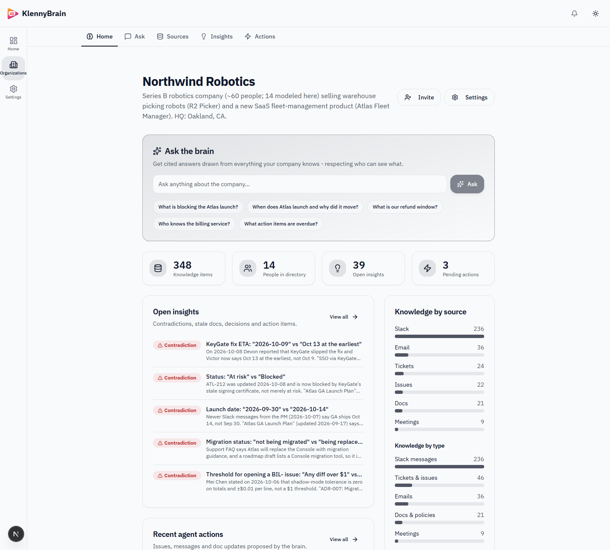
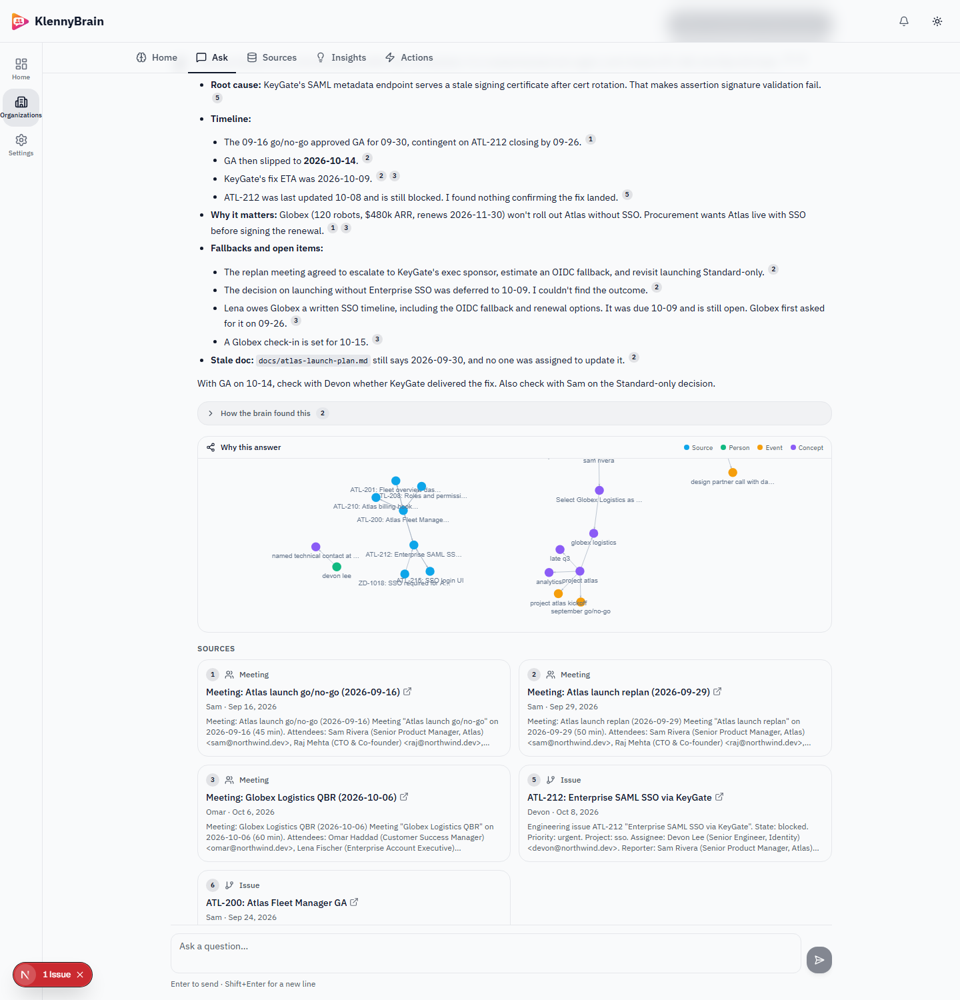
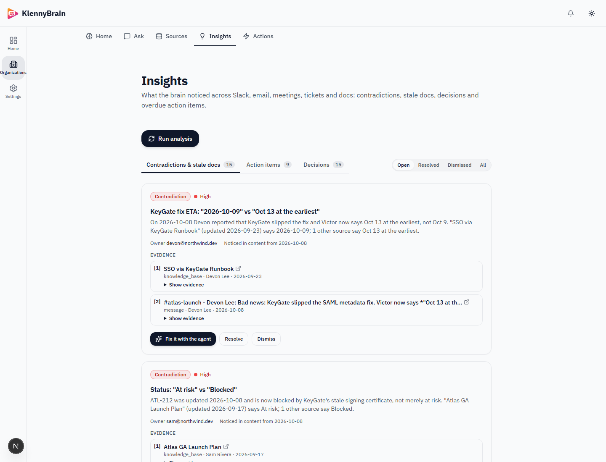
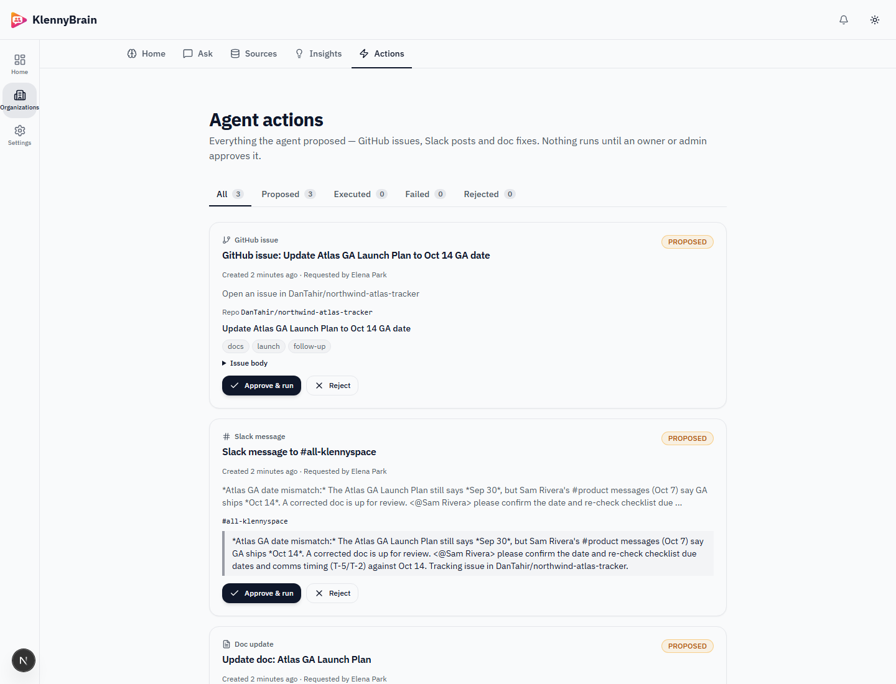
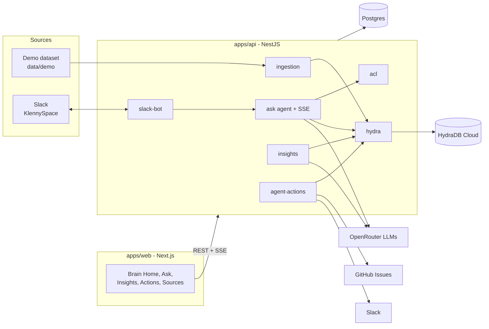
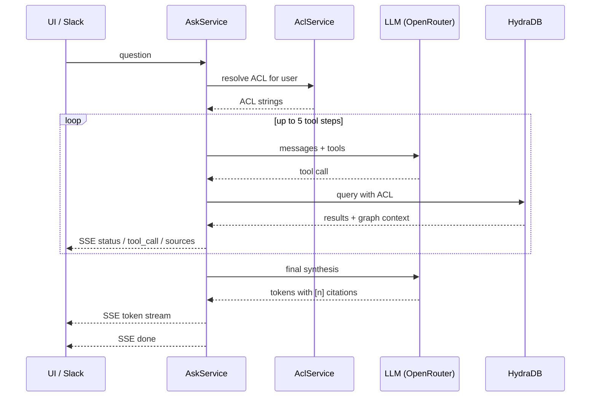

# KlennyBrain

KlennyBrain is a Company Brain built for the Devpost Company Brain Hackathon. It ingests a
company's Slack messages, emails, tickets, meeting transcripts and docs into HydraDB and puts a
tool-calling agent on top. It answers with receipts: every claim is cited, the tool trace is
visible, and a "Why this answer" graph shows the reasoning. It respects who is asking, because
every HydraDB query carries an ACL resolved on the server. It also reads everything proactively,
finds contradictions and stale docs, and proposes fixes (a corrected doc, a Slack message and a
GitHub issue) that only run after an owner or admin approves them. The brain then re-verifies and
corrects itself. It answers in the web app and in Slack, with the same permissions in both.

- 3-minute demo script: [docs/DEMO.md](docs/DEMO.md)
- Devpost write-up: [docs/SUBMISSION.md](docs/SUBMISSION.md)

## Screenshots

<table>
  <tr>
    <td align="center">
      <br>
      <sub>Brain Home</sub>
    </td>
    <td align="center">
      <br>
      <sub>Ask with citations and why-graph</sub>
    </td>
  </tr>
  <tr>
    <td align="center">
      <br>
      <sub>Insights</sub>
    </td>
    <td align="center">
      <br>
      <sub>Approval-gated actions</sub>
    </td>
  </tr>
</table>

## Features

| Judging criterion | What delivers it |
|---|---|
| Technical Execution | NestJS 11 + Prisma 7 + PostgreSQL API, Next.js 16 + React 19 web app, Turborepo and pnpm monorepo. Typed server-sent events defined in a shared TypeScript contract, with a JSON fallback. Batched, idempotent ingestion through a single SourceAdapter interface. Smoke tests with 8 golden-question end-to-end checks. |
| Use of the Brain | HydraDB is the knowledge store: one database per org, explicit relations (`blocks`, `related_to`, `thread_id`, `reply_to`), thinking-mode queries with graph context, subgraph and relations for entity exploration, mandatory ACLs on every search, the feedback API, and upsert for re-sync and self-correction. |
| Agentic Capability | A tool-calling agent (up to 5 tool steps, 60-second budget) with `search_knowledge`, `explore_entity`, `find_experts`, `list_insights`, `propose_github_issue`, `propose_slack_message` and `propose_doc_update`. Actions follow a propose, approve, execute lifecycle; only OWNER and ADMIN can approve. |
| Creativity | The brain corrects itself: it finds a contradiction, proposes a fix, a human approves it, the fix lands in GitHub, Slack and HydraDB, and the related insight auto-resolves. Insights inherit the ACLs of their evidence. |
| Real-World Value | Permission-aware answers (the CEO and the intern get provably different answers), contradiction and stale-doc detection, decisions and overdue action items from meetings, a Slack bot where people already work, and a Brain Home dashboard. |

## How KlennyBrain uses HydraDB

- **One database per org.** Each org gets its own database, `brain_<orgSlug>`, with collection
  `default`.
- **app_knowledge with relations.** Items are ingested as app_knowledge with explicit relations,
  so the graph knows, for example, that ATL-200 is blocked by ATL-212.
- **Small declared metadata schema.** `source_system`, `channel`, `department`, `project`,
  `author` and `doc_type` are declared; everything else goes in `additional_metadata`. Databases
  with a schema reject undeclared keys, and `source_type` is reserved by HydraDB (create returns a
  generic 400), so we use `source_system` instead.
- **ACL on every item.** ACL strings are `<email>` (items tied to one person),
  `group:slack:<channel>` (private Slack channels) or `group:dept:<dept>` (restricted docs).
  Public items carry no ACL.
- **Mandatory ACL on every search.** HydraService refuses to search without an ACL and throws
  `MissingAclError`. In our spike, a query sent without an ACL returned restricted items, so
  unscoped queries are made impossible, including in the insights pipeline.
- **Thinking-mode queries with graphContext.** The agent queries in thinking mode with graph
  context; the returned query paths, plus the subgraph around cited sources, drive the
  "Why this answer" graph.
- **Subgraph and relations for `explore_entity`.** Entity exploration combines HydraDB subgraph and
  relations with the people directory.
- **Feedback API.** Thumbs up and down on answers are forwarded to the HydraDB feedback API.
- **Upsert.** Ingestion runs in batches of 20 with backoff and uses upsert, so re-running a sync is
  idempotent. Upsert is also how an approved action writes a corrected doc back, so the brain
  corrects its own docs.

More detail is in [docs/hydra-findings.md](docs/hydra-findings.md).

## Architecture



Ask flow:



| Path | Purpose |
|---|---|
| `apps/api/src/hydra` | HydraDB client and HydraService; enforces an ACL on every search |
| `apps/api/src/llm` | OpenRouter LLM access for the answer and fast models |
| `apps/api/src/acl` | Server-side identity and ACL resolution, including audited "View as" |
| `apps/api/src/ingestion` | SourceAdapter interface, DemoAdapter, batched upsert and SyncJob progress |
| `apps/api/src/brain` | Brain Home data: stats, suggested questions and integration status |
| `apps/api/src/ask` | Tool-calling agent loop, SSE streaming, JSON fallback and conversations |
| `apps/api/src/insights` | Decisions, action items, contradictions and stale-doc analysis |
| `apps/api/src/agent-actions` | Propose, approve, execute lifecycle for GitHub, Slack and doc actions |
| `apps/api/src/slack-bot` | Bolt Socket Mode bot: mentions, DMs and `/brain` |
| `packages/shared/src/brain` | Typed contract shared by API and web, including the SSE event union |
| `apps/web/src/components/brain` | Web UI components for the brain pages |

## Quick start

Requirements:

- Node 22+
- pnpm 10 (`corepack enable`)
- Docker with Compose
- A HydraDB API key and an OpenRouter API key (required)
- Slack app tokens and a GitHub token (optional)

Keys can be provided in one of two ways:

1. Put them in gitignored files at the repo root: `HydraDBkey.txt`, `OpenRouterKey.txt` and
   `SlackTokens.txt`. `scripts/init-env.mjs` copies them into `apps/api/.env` without printing
   them. The GitHub token is taken from `gh auth token` when the GitHub CLI is logged in.
2. Or edit `apps/api/.env` directly after bootstrap.

```bash
git clone https://github.com/DanTahir/KlennyBrain.git
cd KlennyBrain
pnpm bootstrap   # on Windows run from Git Bash; equivalent: bash scripts/bootstrap.sh
pnpm dev
```

| Service | URL |
|---|---|
| Web | http://localhost:3000 |
| API | http://localhost:3001 |
| Swagger | http://localhost:3001/api/docs |
| Mailpit | http://localhost:8025 |

First run:

1. Log in as `elena@northwind.dev` / `Password123!`.
2. Open **Northwind Robotics**.
3. **Sources** -> **Load demo company** (348 items, about a minute; HydraDB graph indexing
   finishes shortly after).
4. **Insights** -> **Run analysis** (about a minute).
5. Open **Ask** and start asking.

Logins (password `Password123!` for all):

| Email | Persona | Org role | Notes |
|---|---|---|---|
| `elena@northwind.dev` | CEO | OWNER | Sees everything, can approve actions and use "View as" |
| `jordan@northwind.dev` | Eng lead | ADMIN | |
| `marco@northwind.dev` | Support agent | MEMBER | Cannot approve actions |
| `ollie@northwind.dev` | Intern | MEMBER | No access to confidential leadership/HR content |

## Configuration

KlennyBrain variables in `apps/api/.env` (see `apps/api/.env.example`). The app boots without the
optional ones; the related features stay off.

| Variable | Required | Purpose |
|---|---|---|
| `HYDRA_DB_API_KEY` | Required | HydraDB Cloud API key |
| `HYDRA_DB_DATABASE_PREFIX` | Optional | Per-org database prefix (default `brain_`) |
| `OPENROUTER_API_KEY` | Required | OpenRouter API key for all LLM calls |
| `LLM_ANSWER_MODEL` | Optional | Agent loop and answer model (default `anthropic/claude-sonnet-5.5`) |
| `LLM_ANSWER_FALLBACK_MODEL` | Optional | Fallback for the answer model |
| `LLM_FAST_MODEL` | Optional | Fast bulk extraction model (default `anthropic/claude-haiku-5.5`) |
| `LLM_FAST_FALLBACK_MODEL` | Optional | Fallback for the fast model |
| `SLACK_BOT_TOKEN` | Optional | Slack bot token (from installing the app) |
| `SLACK_APP_TOKEN` | Optional | App-level token with `connections:write` for Socket Mode |
| `SLACK_SIGNING_SECRET` | Optional | Slack app signing secret |
| `SLACK_USER_TOKEN` | Optional | Slack user token |
| `SLACK_DEFAULT_ORG_SLUG` | Optional | Org that Slack workspace events map to (default `northwind`) |
| `SLACK_BOT_ENABLED` | Optional | Set to `false` to keep the bot offline (default `true`) |
| `SLACK_USER_MAP` | Optional | Map Slack users to personas: `U123=elena@northwind.dev,...` |
| `SLACK_DEFAULT_PERSONA_EMAIL` | Optional | Persona for unmapped Slack users; empty means public-only answers |
| `GITHUB_TOKEN` | Optional | Token used by the create-issue agent action |
| `GITHUB_ACTIONS_REPO` | Optional | Target repo `owner/repo` for issues |

## Slack bot setup

1. Create a Slack app from `slack/manifest.json`. It configures Socket Mode, the `app_mention` and
   `message.im` events, the `/brain` command, and scopes including `users:read.email`.
2. Create an app-level token with `connections:write` and set it as `SLACK_APP_TOKEN`.
3. Install the app to your workspace and set the bot token as `SLACK_BOT_TOKEN`.
4. Restart the API. Look for the log line `Slack bot connected over Socket Mode`.
5. Run `node scripts/slack-bot-check.mjs` so the bot joins public channels.

Usage:

- `@Brain what is blocking the Atlas launch?` answers in a thread.
- DM the bot directly.
- `/brain who knows the billing service?` answers in-channel.

Replies are Block Kit answers with numbered sources, an "Open in KlennyBrain" button and a footer
stating whose permissions applied.

Permission mapping, in order:

1. `SLACK_USER_MAP=U123=elena@northwind.dev,...`
2. else the directory `slackUserId`
3. else the Slack profile email
4. else `SLACK_DEFAULT_PERSONA_EMAIL`
5. else public-only answers

## GitHub actions setup

Set `GITHUB_TOKEN` to a token with issues write access on the target repo, and
`GITHUB_ACTIONS_REPO=owner/repo`. The demo uses `DanTahir/northwind-atlas-tracker`; an example issue
created by an approved agent action is
https://github.com/DanTahir/northwind-atlas-tracker/issues/1.

## Scripts and tests

| Command | What it does |
|---|---|
| `pnpm verify` | Type-check, lint and unit tests |
| `node scripts/smoke.mjs` | 8 golden-question end-to-end checks against the running API, including the permission difference |
| `node scripts/demo-reset.mjs` | Clears insights and actions, re-syncs demo data (restoring the stale refund doc) and re-runs analysis; run before each demo |
| `node scripts/insights-check.mjs` | CLI for analyze, list, fix, actions, approve and reject |
| `node scripts/slack-bot-check.mjs` | Checks the Slack bot and joins it to public channels |
| `node scripts/demo-data/validate.mjs` | Validates dataset referential integrity |
| `scripts/spikes/*` | HydraDB and LLM spikes; findings in [docs/hydra-findings.md](docs/hydra-findings.md) |

## Demo dataset

The demo company is **Northwind Robotics**, a fictional warehouse robotics company. The dataset has
348 items:

- 236 Slack messages
- 36 emails
- 46 tickets and issues
- 9 meeting transcripts
- 21 docs and policies

plus a 14-person directory. "Today" in the dataset is 2026-10-12. Planted facts and golden
questions are in [data/demo/GROUND_TRUTH.md](data/demo/GROUND_TRUTH.md).

## Limitations and next steps

- The demo adapter is the only ingestion adapter. The SourceAdapter interface is ready for Slack
  history, Gmail, Drive and Notion.
- A Slack workspace maps to a single org via `SLACK_DEFAULT_ORG_SLUG`.
- Jobs run on an in-process job runner; BullMQ on the existing Redis is next.
- There is no full graph explorer page yet, only the per-answer "Why this answer" graph.
- There is no live Slack message ingestion yet.
- Slack conversations from unmapped users are stored under the org owner.

## Credits and license

- Built on [digohq/app-starter](https://github.com/digohq/app-starter) (MIT, Copyright Adam Hong).
  Auth, orgs, roles and notifications come from it, and the `@app-starter/*` package scope is
  kept.
- [HydraDB](https://hydradb.com) for the knowledge store and graph.
- [OpenRouter](https://openrouter.ai) for LLM access.

KlennyBrain is released under the MIT license. See [LICENSE](LICENSE).